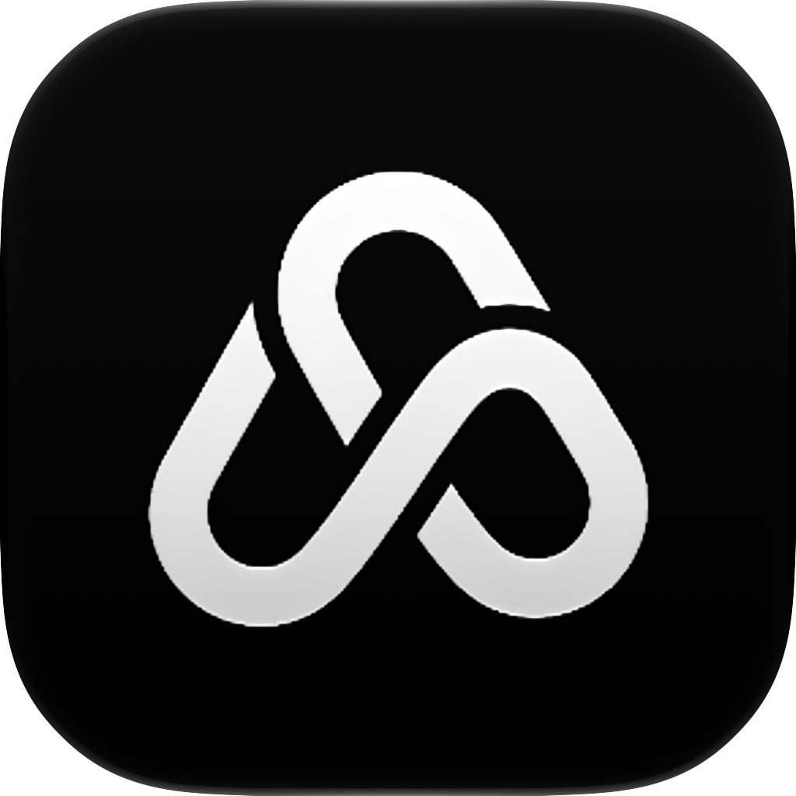

<p align="center">
  
</p>

<h1 align="center">StickShift</h1>

<p align="center"><strong>An IDE for the agentic age.</strong></p>

StickShift puts your coding agent, your diffs, and your Git history in one
window. Run Claude Code next to your repository, watch the changes it makes
land in tabbed diffs, stage what you like, and commit and push without
switching apps. You review and steer; the agent types.

It's a desktop app for macOS, written in [TypeScript](https://www.typescriptlang.org)
with [React](https://reactjs.org/) on [Electron](https://www.electronjs.org/),
and built on the open source [GitHub Desktop](https://github.com/desktop/desktop).
It works with repositories on GitHub, GitHub Enterprise, and any other Git
host.

## Download

Get the latest build from the
[releases page](https://github.com/adesai1000/StickShift/releases/latest).
It's a macOS app for Apple silicon, shipped as a zip. Unzip it and drag
StickShift into Applications.

The build isn't signed with an Apple developer certificate yet, so the first
time you open it, macOS says it can't be verified. Right-click the app,
choose **Open**, then click **Open** again in the dialog. You only have to do
that once per download.

### Coming from GlitchHub Desktop

StickShift used to be called GlitchHub Desktop. The first time StickShift
starts, it copies your repository list, settings, and sign-ins from the
GlitchHub Desktop profile, so you pick up where you left off. The old profile
is left untouched. After you've checked that everything came across, you can
delete GlitchHub Desktop from Applications.

### Updating

StickShift doesn't update itself. To install a newer release:

1. Quit StickShift.
2. Download the zip for the new release from the
   [releases page](https://github.com/adesai1000/StickShift/releases/latest)
   and unzip it.
3. Drag the new StickShift into Applications and choose **Replace**.
4. Right-click the app, choose **Open**, then click **Open** again.

Your repositories, settings, and sign-in live in the profile folder, not in
the app, so they carry over. If macOS asks whether StickShift can use the
keychain, click **Always Allow**. Every build has a new signature, so the
question comes back after an update.

If StickShift is useful to you, a star on the repository helps other people
find it.

## Features

| Feature | Where to find it |
| --- | --- |
| Claude Code in a panel next to your repository, with several sessions | **Claude Code** toolbar button, or <kbd>⌘</kbd>+<kbd>Esc</kbd> |
| Tabs for the files you're reviewing | Changes view, above the diff |
| Open the file in your editor from the diff | Right-click the diff → **Open in** _editor_ |
| Stash selected files | Right-click files in Changes → **Stash Changes** |
| Run `package.json` scripts from the toolbar, with history | **Run Script** toolbar button |
| Expand whole files in diffs by default | Settings → Appearance → Diff Expansion |
| Turn off line wrapping in diffs | Settings → Appearance → Diff Expansion |
| Text size slider | Settings → Appearance → Text Size |
| Default editor per repository | Repository Settings → Editor |
| Sort branches by last update | Settings → Appearance → Branch List |
| Pin branches | Right-click a branch → **Pin Branch** |
| Search tags | Branch dropdown → Tags tab |
| Reorder the repository list | Right-click a repository → **Move Up** or **Move Down** |
| Choose or install your own app icon | Settings → Appearance → App Icon |
| No telemetry, no crash reports, no update pings | Always on |

### Claude Code, built in

Click **Claude Code** at the end of the toolbar, or press
<kbd>⌘</kbd>+<kbd>Esc</kbd>, and a panel opens on the right with Claude Code
running in the current repository. It's the real Claude Code CLI in a real
terminal, so slash commands, permission prompts, and plan mode all work the
way they do in your terminal or editor. Drag the panel's left edge to resize
it; double-click the edge to reset its width.

- **Several sessions.** Click **+** in the panel to start another session.
  Each one gets a tab, named after its conversation once Claude Code names
  it. Close a tab with its **×** or a middle click. The toolbar button shows
  how many sessions are running.
- **Sessions keep running.** Hiding the panel or switching repositories
  doesn't stop anything. Each repository keeps its own sessions, and they're
  there when you come back.
- **Your existing login.** StickShift runs the Claude Code you already have,
  with the same configuration folder, so you're signed in to the same
  account. If you aren't signed in yet, Claude Code walks you through it, and
  links in the terminal open in your browser.
- **Your environment.** Claude Code starts in the repository folder with your
  login shell's environment, so it finds the same tools it finds in your
  terminal.
- **Typing.** Press <kbd>Shift</kbd>+<kbd>Enter</kbd> for a new line in a
  prompt.

Settings → **Claude Code** chooses which installation to run. StickShift
finds the copies on your computer: the native installer's
`~/.local/bin/claude`, Homebrew, anything on your `PATH`, and the copies
bundled with the Claude Code extension for VS Code, VSCodium, Cursor, and
Windsurf. By default it runs the newest one; you can pick another or point
it at any `claude` executable. The same tab can point Claude Code at a
different configuration folder, such as `~/.claude-work`, if you keep
separate logins.

Changes to those settings apply when a session starts. Sessions that are
already running keep what they started with and show a notice; click
**Restart** in the notice, or the restart button in the panel, to pick up the
new settings.

### Tabs above the diff

In the Changes view, every file you click in the list opens as a tab above
the diff, so you can flip between the files you're reviewing the way you
would in an editor. The list selection follows the active tab.

Close a tab with its **×** button, a middle click, or <kbd>Delete</kbd> while
it has focus, and move between tabs with the arrow keys. Right-clicking a tab
offers **Close**, **Close Others**, **Close to the Right**, and **Close All**.
Tabs for files you commit or discard close on their own, and when two open
files share a name, both tabs show their folder.

### Run package.json scripts from the toolbar

The **Run Script** button runs a script from the repository's `package.json`
in the repository folder, with your login shell's environment, and streams
its output into a terminal view with a **Stop** button. Long-running scripts
such as `dev` or `test:watch` keep running while you work.

Nothing is exposed until you opt in. Repository Settings → **Scripts**, or
Settings → **Scripts**, lists every script with a **Show** checkbox, and a
**Confirm** checkbox for the ones that deserve a second look, like a
production deploy. The package manager is detected from the lock file (npm,
Yarn, pnpm, or Bun) and can be overridden. The button's **History** tab keeps
the last 20 runs per repository, with their status, duration, and output.

### Diffs your way

- **Whole files by default.** Settings → Appearance → **Diff Expansion** →
  _Whole file_ opens every diff fully expanded, in Changes, History, stash
  previews, and the pull request dialog. The diff's context menu still
  collapses or expands a single file.
- **No wrapping.** Turn off _Wrap long lines_ in the same setting, and long
  lines scroll sideways instead.
- **Open in your editor.** Right-click the diff text and choose **Open in**
  followed by your editor's name. It uses the editor from Settings →
  Integrations, or the repository's own editor from Repository Settings →
  **Editor**.
- **Stash just some files.** Right-click a file in the Changes list, or a
  selection of files, and choose **Stash Changes**. Only those files are
  stashed, untracked ones included. Like **Stash All Changes**, it replaces
  the branch's existing stash after asking.

### Smaller things

- **Text size.** Settings → Appearance → **Text Size** scales all text from
  10 px to 18 px, live while you drag.
- **Default editor per repository.** Repository Settings → **Editor**
  overrides the editor from Settings for that repository.
- **Branches.** Sort them by last update in Settings → Appearance → Branch
  List, pin the ones you use most, and search tags from the branch dropdown.
- **Repository order.** Right-click a repository and choose **Move Up** or
  **Move Down**.
- **App icon.** Settings → Appearance → **App Icon** sets the icon in the
  Dock and the Finder. **Install Icon…** takes any `.icns` file or 1024 px PNG.
- **Command line tool.** Choose **Install Command Line Tool** in the app menu
  to get a `stickshift` command. Run `stickshift` in a repository to open it,
  or `stickshift clone OWNER/REPO` to clone one.

### Nothing phones home

StickShift sends no usage statistics, no crash reports, and no update checks.
The reporting code is compiled out, and the About dialog points at the
releases page instead of checking for updates. Talking to GitHub for your
repositories, pull requests, sign-in, and notifications works as usual; only
the reporting is gone.

## Troubleshooting

### "The repository does not seem to exist anymore"

If fetching or pushing a repository that belongs to a GitHub organization
fails with this message while the same commands work in a terminal, the
organization has turned on _OAuth App access restrictions_ and hasn't
approved the OAuth app that StickShift signs in through. GitHub answers every
request from an unapproved app with a 404, which the app shows as this
message. The terminal works because `gh`, SSH keys, and personal access
tokens aren't OAuth apps.

StickShift signs in through the OAuth app named **GitHub Desktop Dev**, which
comes from the open source project it's built on. There are two ways to fix
the error.

**Ask the organization to approve the app.** On github.com, go to
**Settings > Applications > Authorized OAuth Apps > GitHub Desktop Dev**.
Under **Organization access**, click **Grant** if you own the organization, or
click **Request** and have an owner approve it under the organization's
**Settings > Third-party access**. This is a one-time fix, and it survives
signing out and back in.

**Use a personal access token instead.** Classic tokens aren't subject to the
restriction. Do this if you can't get the app approved:

1. On github.com, go to **Settings > Developer settings > Personal access
   tokens > Tokens (classic)** and generate a token with the `repo`, `user`,
   and `workflow` scopes. Use a classic token; fine-grained tokens don't
   report their scopes back to the app.
2. If the organization enforces SAML single sign-on, click **Configure SSO**
   next to the new token and authorize it for the organization.
3. Sign in to StickShift as usual so the account exists, then quit the app.
4. Replace the stored token in the keychain. Replace `LOGIN` with your GitHub
   username and `TOKEN` with the token:

   ```shellsession
   $ security add-generic-password -U -s "GitHub - https://api.github.com" -a LOGIN -w "TOKEN"
   ```

5. Start the app. When macOS asks whether StickShift can read the keychain
   item, click **Always Allow**.

Signing out and back in writes a fresh OAuth token over the stored one, so
repeat step 4 afterwards.

If the message appears for one repository only and a token doesn't help,
check its remote in **Repository > Repository Settings > Remote**, or run
`git remote -v` in a terminal. A URL with no owner and name, such as
`https://github.com/`, produces the same message.

### Claude Code doesn't start

If the panel says StickShift couldn't find Claude Code, install it, or open
Settings → **Claude Code** and choose its location. StickShift looks for it
on your login shell's `PATH`, so a `claude` that works in your terminal is
usually found automatically.

## Building it

Follow the [setup guide](docs/contributing/setup.md) for the prerequisites:
Node, Yarn, Python 3, and the Xcode command line tools. The repository pins
Node 24.19 in `.node-version`. Use that exact version; older 24.x releases
silently fail to package the app.

```shellsession
$ yarn                 # install dependencies
$ yarn build:dev       # build the development app bundle
$ yarn start           # launch it with hot reload for the UI
```

Changes under `app/src` reload live. If the window doesn't refresh on its
own, press <kbd>⌘</kbd>+<kbd>⌥</kbd>+<kbd>R</kbd> in the app. Changes to the
main process or the packaging need `yarn build:dev` again.

To regenerate the macOS icon after editing `app/static/logos/*/icon-logo.icon`
in Icon Composer, run `script/build-icon-assets.sh`. It needs a full Xcode
install, not just the command line tools.

## Built on GitHub Desktop

StickShift is built on [GitHub Desktop](https://github.com/desktop/desktop)
and merges its changes regularly. Report problems with StickShift in this
repository's [issues](https://github.com/adesai1000/StickShift/issues),
not to the GitHub Desktop maintainers.

## License

**[MIT](LICENSE)**, the same license as GitHub Desktop. The license file keeps
GitHub's copyright notice for the code StickShift is built on, as the MIT
license requires.

StickShift isn't affiliated with or endorsed by GitHub or Anthropic. GitHub
is a trademark of GitHub, Inc., and Claude is a trademark of Anthropic, PBC.
